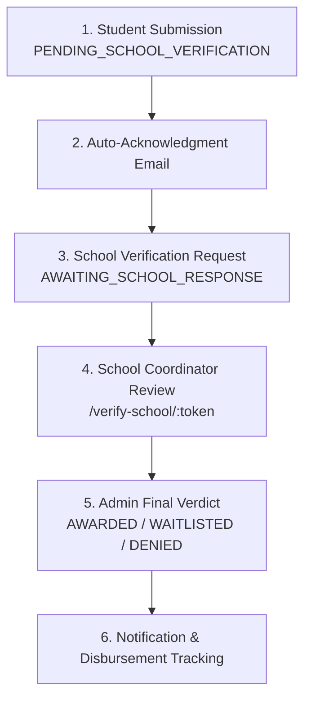

# 🎓 EduScholar

**A unified scholarship, bursary, and work-study management platform for Quezon City.**
EduScholar digitizes the full lifecycle of financial-aid programs, from student application and school verification to admin decisions and disbursement tracking, with a focus on transparency, separation of duties, and data privacy.

---

## ✨ Features

- **Scholarships, Bursaries & Work-Study** – browse opportunities, apply online, and track status in real time.
- **6-Stage Verified Workflow** – student submission → auto-acknowledgment → school routing → coordinator review → admin verdict → notification & disbursement.
- **Multi-Role Portals** – Student, School Coordinator, Supervisor, Treasury, and Admin dashboards.
- **Document Vault** – secure upload and management of application documents.
- **Messaging, Live Chat & AI Chat Widget** – in-app communication and support tickets.
- **Calendar & Notifications** – deadlines, events, and alerts.
- **Scholar ID / QC ID** – QR-based identification and interoperability endpoints.
- **Batch School Verification** – partner schools verify applicants via expiring token links.
- **Reports & Audit Trail** – immutable audit logs retained for 7 years.
- **Security** – JWT auth, bcrypt hashing, TOTP/OTP verification, Helmet, CORS, and a post-build security scan.
- **Light / Dark Mode** UI.

---

## 🏗️ Tech Stack

| Layer | Technologies |
| :--- | :--- |
| **Frontend** | React 19, TypeScript, Vite, Tailwind CSS 4, React Router 7, React Hook Form + Zod, Axios, Sonner, Lucide |
| **Backend** | Node.js (Express 5), JWT, bcryptjs, speakeasy (OTP), Nodemailer, ws (WebSockets), Swagger UI |
| **Database** | PostgreSQL (Neon / any hosted Postgres) via `pg` |
| **Tooling** | Model Context Protocol (MCP) server, Docker & Docker Compose, Traefik, Nixpacks |
| **Hosting** | Railway, Vercel, Render, or localhost (environment-flexible) |

---

## 📁 Project Structure

```
EduScholar/
├── frontend/              # React + Vite web app
│   ├── src/pages/         # admin, auth, public, school, shared, student, supervisor, treasury
│   ├── src/components/    # layout, shared UI (incl. AIChatWidget)
│   └── src/api/           # API clients (calendar, workStudy, ...)
├── backend/               # Express REST API
│   ├── routes/            # applications, scholarships, bursaries, workStudy, funds, tickets, ...
│   ├── controllers/  models/  middleware/  services/  realtime/
│   ├── db/                # schema & reset scripts
│   ├── mcp/               # EduScholar MCP server
│   └── docs/              # API docs
├── api/                   # Serverless entry (Vercel)
├── scripts/  tools/       # Utility & maintenance scripts
├── docker-compose*.yml    # Local, microservices, and tunnel setups
├── Dockerfile  railway.json  vercel.json  nixpacks.toml
└── *.md                   # Architecture, workflow, security & planning docs
```

---

## 🔄 Application Workflow



**Disbursement tracking (Model A):**
`PENDING → ELIGIBLE → SCHEDULED → PROCESSING → RELEASED → RECONCILED`
EduScholar tracks milestones only. It does not hold funds. A two-person rule requires the initiator and approver to be different people.

**Partner schools:** Bestlink College of the Philippines (BCP), Quezon City University (QCU), St. Claire College of Caloocan.

For the full breakdown, see [SYSTEM_WORKFLOW.md](SYSTEM_WORKFLOW.md).

---

## 🚀 Getting Started

### Prerequisites
- Node.js **22+**
- A PostgreSQL database (e.g. [Neon](https://neon.tech))

### 1. Clone
```bash
git clone <your-repo-url>
cd "EduScholar Revise"
```

### 2. Configure environment
Copy `backend/.env.example` to `backend/.env` and set your values. The backend accepts any of these database variables, so the same data works on any host:

```
DATABASE_URL=postgres://...
# or POSTGRES_URL / NEON_DATABASE_URL
```

### 3. Run the backend
```bash
cd backend
npm install
npm run dev
```

### 4. Run the frontend
```bash
cd frontend
npm install
npm run dev
```

Or use the helper script on Windows: `./run-local-dev.ps1`

### Docker
```bash
docker compose up --build
```

### Useful backend scripts
| Command | Purpose |
| :--- | :--- |
| `npm start` | Start the API |
| `npm run dev` | Start with auto-reload (nodemon) |
| `npm run db:pull` / `db:push` | Sync database |
| `npm run mcp` | Launch the EduScholar MCP server |

---

## 🔐 Security & Compliance

- **Separation of duties** – no single actor can apply, verify, approve, and disburse.
- **Data Privacy Act (RA 10173)** – explicit consent, expiring 72-hour token links, and public legal pages (`/privacy`, `/terms`, `/refund-policy`, `/cookies`).
- **Audit logging** – IP, user-agent, timestamp, and actor recorded for every state change.
- **100% database-driven** – no hardcoded or dummy records; all data comes from the persistent cloud database.

See [system_security_inventory.md](system_security_inventory.md) for details.

---

## 📚 Documentation

| Document | Description |
| :--- | :--- |
| [SYSTEM_WORKFLOW.md](SYSTEM_WORKFLOW.md) | Workflow & compliance guide |
| [BACKEND-DATABASE.md](BACKEND-DATABASE.md) | Database & backend reference |
| [complete_architecture_diagrams.md](complete_architecture_diagrams.md) | Architecture diagrams |
| [CITIZENS_CHARTER.md](CITIZENS_CHARTER.md) | Citizen's Charter |
| [FALLBACK_ARCHITECTURE.md](FALLBACK_ARCHITECTURE.md) | Resilience design |
| [DEVELOPMENT_PROGRESS.md](DEVELOPMENT_PROGRESS.md) | Progress tracking |

---

## 📄 License

ISC (backend). Add or update the license to match your project's terms.
