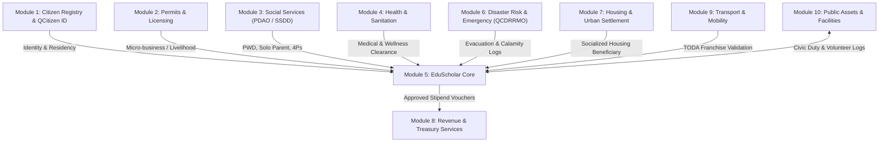
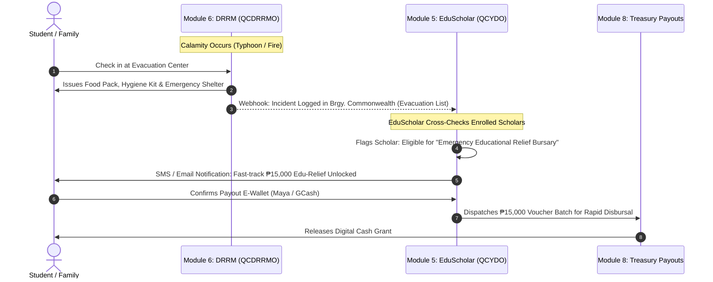

# Quezon City Local Government Enterprise Interoperability Implementation Plan
## Subsystem 5: Education & Scholarship Management (EduScholar / Campus Aid Hub)

---

## 1. Executive Summary & Architectural Overview
This Implementation Plan operationalizes the integration between **Subsystem 5 (EduScholar / QCYDO)** and the **9 other Quezon City Government Subsystems**. The objective is to transition from manual, paper-heavy citizen verifications to an automated, event-driven inter-agency data exchange while maintaining strict security, data privacy (RA 10173), and database continuity.

---

## 2. Phase-by-Phase Rollout Roadmap

### Phase 1: Identity & Social Equity Gateway (Weeks 1 – 2)
* **Target Modules**: Module 1 (Citizen Information) & Module 3 (Social Services).
* **Focus**: Auto-populating Step 1 (Personal & Residency info) and auto-verifying Step 3 Special Inclusions (PWD, Solo Parent, 4Ps).
* **Outcome**: 70% reduction in applicant form fatigue and zero paper residency submissions.

### Phase 2: Livelihood & Vulnerable Sector Validation (Weeks 3 – 4)
* **Target Modules**: Module 9 (Transport / TODA), Module 2 (BPLD), Module 7 (Housing).
* **Focus**: Auto-validating TODA dependents, informal sector livelihood, and socialized housing status.
* **Outcome**: Instant eligibility cross-checks for the Economic & Need-Based Scholarship tracks.

### Phase 3: Emergency Bursaries & Student Wellness (Weeks 5 – 6)
* **Target Modules**: Module 6 (Disaster Risk & Emergency) & Module 4 (Health).
* **Focus**: Webhook triggers for Calamity Evacuees to fast-track the ₱15,000 Emergency Educational Relief Bursary; Medical clearances for athletes.
* **Outcome**: Automatic disaster safety nets without conflicting with Module 6's physical food pack distribution.

### Phase 4: Financial Settlement & Civic Duty Verification (Weeks 7 – 8)
* **Target Modules**: Module 8 (Treasury Payouts) & Module 10 (Public Assets / Community Service).
* **Focus**: Batch transmission of approved scholar vouchers to City Treasury (Landbank/Maya/GCash); automatic ingestion of student community service hours for term renewals.
* **Outcome**: Fully automated end-to-end scholarship lifecycle from intake to stipend payout.

---

## 3. Subsystem Integration Matrix & Technical Specifications

| Subsystem | Responsible Office | Integration Touchpoint in EduScholar | Protocol & Data Format | Primary Endpoint / Webhook | Expected Data Payload / Contract |
| :--- | :--- | :--- | :--- | :--- | :--- |
| **Module 1: Citizen Registry & Engagement** | ITDD / QCitizen | **Step 1: Basic Information** | REST (JSON) + API Key | `GET /api/citizens/lookup?qcid={id}` | `qcid`, `fullName`, `dob`, `gender`, `civilStatus`, `barangay`, `district`, `address`, `isVerified` |
| **Module 2: Permits & Licensing** | BPLD | **Step 3: Household Financial Profile** | REST (JSON) | `GET /api/bpld/verify?parent_id={id}` | `permitNumber`, `businessName`, `businessType`, `grossIncomeBracket`, `status` |
| **Module 3: Social Services Management** | SSDD / PDAO | **Step 3: Special Sector Inclusions** | REST (JSON) | `GET /api/social-services/verify?citizen_id={id}` | `citizenId`, `isPwd`, `pdaoId`, `isSoloParent`, `ssddCardNo`, `is4PsBeneficiary`, `isIndigent` |
| **Module 4: Health & Sanitation** | QCHD | **Step 4: Requirement Uploads** | REST (JSON) | `GET /api/health/clearance/{code}` | `clearanceCode`, `patientName`, `facility`, `fitToStudy`, `issuedAt` |
| **Module 6: Disaster Risk Reduction & Mgmt** | QCDRRMO | **Bursaries & Calamity Protection** | Webhook / REST | `POST /api/interop/drrm/webhook` `GET /api/drrm/incidents` | `incidentId`, `incidentType` (Fire/Typhoon), `affectedBarangays` (Array), `evacuationCenter`, `declaredAt` |
| **Module 7: Housing & Urban Settlement** | HCDRD / HURD | **Step 1 & 3: Urban Poor Housing** | REST (JSON) | `GET /api/housing/beneficiary?id={id}` | `beneficiaryId`, `housingProject`, `householdHead`, `relocationStatus`, `isUrbanPoor` |
| **Module 8: Revenue & Treasury Services** | City Treasury | **Stage 6: Stipend Payout & Vouchers** | REST (JSON) + Mutual TLS | `POST /api/treasury/disbursement-batches` | `batchId`, `grantProgram`, `totalAmount`, `scholars`: `[{studentId, accountName, channel, accountNumber, amount, voucherCode}]` |
| **Module 9: Transport & Mobility Management** | TFRB | **Step 3: TODA Dependent Inclusions** | REST (JSON) | `GET /api/transport/toda/verify?franchise_no={id}` | `franchiseNo`, `operatorName`, `todaAssociation`, `routeJurisdiction`, `isFranchiseActive` |
| **Module 10: Public Assets & Facilities** | QC Youth Centers / Public Libraries | **Student Renewal & Civic Duty Tracker** | REST (JSON) | `GET /api/facilities/volunteer-hours?student_id={id}` | `studentId`, `totalHoursRendered`, `lastActivityDate`, `facilityName`, `supervisorSignature` |

---

## 4. Module 6 (Disaster Risk Reduction) Deep Dive: Division of Responsibilities

### Clarification on Assistance Types:
1. **Module 6 Role**: Immediate Disaster Mitigation & Survival (Physical relief packs, rescue, medical triage, shelter).
2. **Module 5 (EduScholar) Role**: Academic Continuity & Schooling Protection (Replacing burned books/laptops, transport allowances, fee balances).
3. **No Duplicate Release**: Module 6 issues **goods**; Module 5 issues **student educational stipends**.

---

## 5. Security, Audit Trail & Data Governance Policies
1. **Zero Fake Data Policy**:
   - All interop calls connect directly to active databases or live service gateway URLs. Mock objects and dummy fallbacks are strictly prohibited.
2. **Data Privacy (RA 10173)**:
   - Sensitive personal information (DOB, medical status, financial income) is encrypted in transit via HTTPS/TLS 1.3 and hashed where appropriate.
3. **Immutable Audit Logging**:
   - Every inbound and outbound inter-system transaction is recorded in the PostgreSQL `interop_logs` and `audit_logs` tables with caller IP, timestamp, actor role, and transaction hash.
4. **Graceful Fallback Mode**:
   - If an external subsystem is temporarily offline or undergoing maintenance, EduScholar safely reverts to manual field entry without crashing or blocking the student's submission.

---

## 6. Action Items & Team Coordination Checklist

### Step 1: Outreach to Subsystem Leads
- [ ] Share the **JSON payload requirements** with Module 1, 3, 6, 8, and 9 leads.
- [ ] Agree on authentication token format (Bearer JWT vs. Header API Keys).
- [ ] Secure test URLs or shared local ports for joint integration testing.

### Step 2: Implementation in EduScholar Backend
- [ ] Activate Subsystem Adapters in `backend/services/interopService.js`.
- [ ] Configure environment variables in `.env` (`MODULE1_URL`, `MODULE3_URL`, `MODULE6_URL`, `MODULE8_URL`).
- [ ] Implement retry policies and response caching for high-load application submission periods.

### Step 3: Frontend Pre-fill & Verification Badging
- [ ] Add **"Verified by QC Citizen Registry"** badge on Step 1 fields.
- [ ] Add **"Verified by QC PDAO / SSDD"** badge on Step 3 special sector checkboxes.
- [ ] Enable real-time QCID auto-lookup in `ApplicationForm.tsx`.
