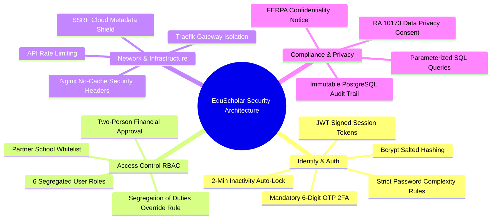

# 🛡️ EduScholar Existing System Security Inventory

This document provides a comprehensive inventory of all **security mechanisms, access control policies, data privacy controls, and network safeguards** currently implemented and active in the EduScholar platform (`eduscholar.up.railway.app`).

---

## 🔐 1. Authentication & Identity Safeguards

| Security Feature | Technical Implementation | Purpose / Threat Protection |
| :--- | :--- | :--- |
| **Bcrypt Password Hashing** | `bcrypt.hash(password, 10)` | Secures stored passwords with salted hashing (cost factor 10) to prevent rainbow table attacks. |
| **Strict Password Policy** | `validateStandardPassword()` | Enforces min 12 characters, uppercase, lowercase, numeric digit, and symbol. Blocks weak passwords or passwords containing user name/email. |
| **Multi-Role 2FA (6-Digit OTP)** | `otpModel`, `verifyOtp` | Mandatory 6-digit One-Time Password verification sent to email (valid for 10 mins) required for logging in across all 6 roles. |
| **JWT Session Security** | `jwt.sign()` with `JWT_SECRET` | 7-day cryptographically signed JSON Web Tokens for stateless authenticated API sessions. |
| **Mandatory Email Verification** | `otpModel.createVerificationToken()` | Requires new applicants to click a 60-minute expiring token link before their account can be authorized. |
| **Inactivity Session Lock** | `SessionLockModal.tsx` | Automatically locks active user sessions after 2 minutes of inactivity, requiring re-authentication to prevent unauthorized access on shared devices. |

---

## 🛡️ 2. Authorization & Access Control (RBAC)

| Security Control | Technical Implementation | Enforcement Boundary |
| :--- | :--- | :--- |
| **Role-Based Access Control (RBAC)** | `ProtectedRoute.tsx` & `authMiddleware` | Enforces strict role checks across 6 user roles (`student`, `admin`, `supervisor`, `school_coordinator`, `treasury`, `system_admin`). |
| **Whitelisted School Domain Restrictions** | Backend verification & whitelist model | Restricts partner school verification to 3 whitelisted partner institutions (`BCP`, `QCU`, `St. Claire`). |
| **Segregation of Duties (SoD)** | `ApplicationReviewQueuePage.tsx` | Prevents System Admins from overriding a School Coordinator's verdict without mandatory written rationale logged in audit trails. |
| **Two-Person Financial Rule** | Model A Disbursement Control | Ensures financial milestone approvals enforce `initiator !== approver` before disbursement state changes to `RELEASED`. |

---

## 🌐 3. Network, Infrastructure & API Security

| Protection Layer | Technical Implementation | Threat Protection |
| :--- | :--- | :--- |
| **SSRF (Server-Side Request Forgery) Protection** | `isSafeClientUrl()` | Blocks requests targeting AWS/GCP cloud metadata IPs (`169.254.169.254`, `metadata.google.internal`) and private RFC1918 networks (`10.x.x.x`, `192.168.x.x`, `172.16.x.x`). |
| **Rate Limiting** | `express-rate-limit` (`authLimiter`) | Limits authentication and OTP requests to prevent brute-force credential stuffing and denial-of-service (DoS) attacks. |
| **Nginx Security Headers** | `frontend/nginx.conf` | Enforces `Cache-Control: "no-cache, no-store, must-revalidate"`, `X-Frame-Options: SAMEORIGIN`, and `X-Content-Type-Options: nosniff`. |
| **Traefik Reverse Proxy Isolation** | `docker-compose.yml` | Edge routing gateway isolating frontend, backend API (`/api`), WebSockets (`/ws`), and database networks. |

---

## ⚖️ 4. Data Privacy & Legal Compliance Guards

| Compliance Rule | Technical Implementation | Reference / Standard |
| :--- | :--- | :--- |
| **Data Privacy Act Consent** | Mandatory consent checkbox on `/apply` | **RA 10173 (Data Privacy Act of 2012)** compliance; explicitly obtains student consent before processing PII. |
| **FERPA Confidentiality Headers** | Embedded notice on all coordinator emails | Prevents illegal dissemination of educational records to unauthorized third parties. |
| **Immutable Audit Logging** | `audit_logs` table in PostgreSQL | Logs user ID, IP address, user-agent, action type, and timestamp on all sensitive actions (reviews, approvals, disbursements). |
| **SQL Injection Protection** | Parameterized queries (`$1`, `$2`) via `pg` pool | Prevents SQL injection attacks by escaping all user inputs in backend database queries. |

---

## 📊 Summary Matrix

